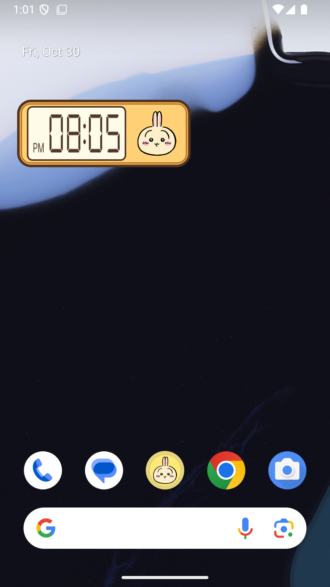

# 우사기 알람

[**APK 다운로드 · usagi_alarm_v1.4.0.apk (v1.4.0)**](https://github.com/eva01sin/usagi_alarm/releases/download/v1.4.0/usagi_alarm_v1.4.0.apk)

Android 8.0 이상, Android 기본 UI와 Java 17을 사용하는 로컬 앱입니다. 서버·회원가입·복용 기록은 없습니다.

이 앱은 수익 창출을 하지 않는 비영리 개인 프로젝트입니다. 광고, 유료 판매, 인앱 결제를 통한 수익을 얻지 않습니다.

변조하지마시고 자유로이 사용해주세요. 다만 출처는 남겨 주시기 바랍니다.

## 업데이트 내역

### v1.4.0 · 2026-11-04

- **한국 공휴일엔 알람 울리지 않기** 스위치를 추가했습니다(기본 꺼짐). 켜면 알람이 한국 공휴일을 건너뛰고 다음 날짜로 울립니다. 반복 알람·한 번만 울리는 알람 모두 적용되고, 사전 알림도 함께 건너뜁니다. 5분 뒤 다시 울리는 알람은 그대로입니다. 기기 지역·언어와 상관없이 한국 기준입니다.
- 앱이 직접 계산하는 공휴일: 양력 고정 공휴일(노동절 5/1·제헌절 7/17은 2026년부터), 설날·추석 연휴, 부처님오신날, 대체공휴일. 음력은 기기 내장 달력으로 계산하므로 따로 갱신할 필요가 없습니다. 임시공휴일·선거일은 내장하지 않습니다.
- **캘린더에서도 공휴일 가져오기** 스위치를 추가했습니다(기본 꺼짐, 위 스위치를 켜야 사용 가능). 켜면 기기의 구글 캘린더 `대한민국 공휴일`에서 임시공휴일·선거일 등을 읽어 함께 건너뜁니다. 앱을 업데이트하거나 목록을 갱신하지 않아도 구글 캘린더가 동기화되면 자동으로 반영됩니다.
  - **캘린더 읽기 권한(READ_CALENDAR)** 이 필요하며 스위치를 켤 때 요청합니다. 거부하면 스위치는 꺼진 채로 남고, 나중에 권한을 철회하면 내장 계산만 씁니다. 읽는 것은 공휴일 캘린더의 종일 일정 날짜뿐이며 기기 밖으로 보내거나 저장하지 않습니다.
  - 알람이 울리기 직전에 오늘이 공휴일인지 다시 확인하므로, 알람을 맞춘 뒤 발표된 임시공휴일도 건너뜁니다. 조회에 실패하면 알람은 평소처럼 울립니다.
  - 기기에 공휴일 캘린더가 동기화돼 있지 않으면(구글 계정·캘린더 동기화 필요) 설정 화면에 안내가 뜨고 내장 계산만 씁니다.
- 한계: 캘린더를 켜지 않은 경우 임시공휴일·선거일은 반영되지 않습니다. 법이 바뀌어 새로 생기는 고정 공휴일은 앱 업데이트가 필요합니다. 2027-05-03(노동절 대체)처럼 자료마다 달라지는 날짜는 월력요항 발표 후 확인이 필요합니다. 실제 휴대폰의 절전·배터리 최적화와 구글 캘린더 실제 동기화는 확인하지 못했습니다(에뮬레이터에서 시험용 로컬 캘린더로 확인).

### v1.3.1 · 2026-11-03

- 설정 화면의 언어 선택을 세로로 늘어선 라디오 버튼에서 한 줄짜리 드롭다운 메뉴로 바꿨습니다. 누르면 `시스템 설정 따라가기` / `한국어` / `English`가 펼쳐지고, 고르면 화면이 바로 새 언어로 바뀝니다.
- 홈 화면 위젯의 왼쪽 여백을 줄여, 숫자판과 테두리 사이 간격이 왼쪽·위·아래 모두 같아졌습니다.
- 에뮬레이터에서 새 화면을 직접 확인하지 못했습니다(빌드·단위 테스트·lint만 통과).

### v1.3.0 · 2026-11-03

- 영어를 지원합니다. 설정 화면 맨 아래 **언어**에서 `시스템 설정 따라가기`(기본값) / `한국어` / `English`를 고를 수 있고, 고르면 화면이 바로 새 언어로 바뀝니다.
- `시스템 설정 따라가기`는 기기 언어가 한국어이면 한국어, 그 외 언어이면 영어로 표시합니다.
- 알람이 울릴 때의 알림과 알람 화면, 홈 화면 위젯의 문구도 선택한 언어를 따릅니다. 위젯 시각은 기존처럼 AM/PM 디지털 표기입니다.
- 홈 화면의 앱 이름과 위젯 목록의 이름·설명은 앱 설정이 아니라 기기 언어를 따릅니다.
- 다른 앱을 사용 중에도 알람이 울리면 알람 화면이 바로 열립니다. 설정 화면의 안내에서 **다른 앱 위에 표시**(`설정 열기`)를 허용해야 하며, 허용하지 않으면 사용 중에는 이전처럼 상단 알림 카드로만 표시됩니다. 화면이 꺼져 있거나 잠겨 있을 때는 허용 여부와 상관없이 기존처럼 알람 화면이 열립니다. 허용하면 안내는 설정 화면에서 사라집니다.
- 폴더블·큰 화면 대응: 펼친 안쪽 화면이나 태블릿처럼 크고 정사각형에 가까운 창에서는 설정 화면을 2열로 배치하고 폭이 지나치게 늘어나지 않게 했습니다. 알람 화면은 캐릭터와 시계 숫자, `5분만...`/`알람 끄기` 버튼이 잘리지 않도록 그림 자르는 위치를 창 비율에 맞췄고, 알람이 울리는 중에 창 크기가 바뀌어도(접기·펴기) 소리와 화면이 끊기지 않게 했습니다. 일반 폰의 모습은 그대로입니다. 에뮬레이터의 화면 크기 변경으로만 확인했으며 실제 폴더블 기기에서는 확인하지 못했습니다. 접은 화면 전용 UI와 반쯤 접은 자세(탁상) 대응은 포함하지 않습니다.

### v1.2.7 · 2026-10-31

- `5분만...`을 누르면 알람이 멈추고 5분 뒤로 다시 예약된 뒤 홈 화면으로 이동합니다.
- 위젯 액정이 예약된 알람 시각 대신 현재 시각을 표시하고 매 분 갱신됩니다. 정확한 알람 권한이 없거나 기기가 절전 상태이면 갱신이 늦어질 수 있습니다.
- 위젯 시각의 콜론(:)이 1초마다 깜박입니다. 숫자와 AM/PM 위치는 움직이지 않습니다.
- 얼굴 버튼으로 알람을 켜고 끄는 동작은 그대로입니다.

### v1.2.6 · 2026-10-30

- 위젯 액정의 AM을 왼쪽 위, PM을 왼쪽 아래에 표시하도록 수정했습니다.

### v1.2.5 · 2026-10-30

- 3×1 홈 화면 위젯을 추가했습니다. 디지털 시각을 확인하고 우사기·모몽가 얼굴 버튼으로 알람을 켜고 끌 수 있습니다.
- 홈 화면을 길게 눌러 위젯 목록에서 추가하세요. 기존 위젯은 삭제 후 다시 추가하면 새 크기가 적용됩니다.

### v1.2.0 · 2026-10-30

- 알람 화면을 터치하면 `5분만...`과 `알람 끄기` 버튼이 나타납니다.
- `5분만...`을 누르면 5분 후 사전 알림 없이 본 알람으로 다시 울립니다. 다음 요일 반복 예약은 유지됩니다.
- 홈 화면을 길게 눌러 위젯 목록에서 `우사기 알람`을 추가할 수 있습니다.
- 위젯에서 다음 알람·다시 알림 시각을 확인하고 알람을 켜거나 끌 수 있습니다. 이미지나 시각을 누르면 설정 화면이 열립니다.
- 설정 화면이나 위젯에서 알람을 끄면 대기 중인 다시 알림도 취소됩니다.

### v1.1 · 2026-10-30

- 알람 화면에서 뒤로가기·홈·최근 앱 버튼으로 나가면 현재 알람이 꺼집니다.
- 사전 알림 중 종료하면 이번 본 알람도 건너뛰며, 다음 반복 예약은 유지됩니다.
- 앱 버전과 화면 하단 버전 표기를 1.1로 업데이트했습니다.

## 이미지 출처

- 위젯 디지털 숫자 서체: [DSEG7 Classic · keshikan](https://www.keshikan.net/fonts-e.html), SIL Open Font License 1.1. 라이선스는 APK의 `assets/DSEG-LICENSE.txt`에 포함되어 있습니다.

- 우사기 얼굴 원본: [치이카와 마켓 공식 우사기 컬렉션](https://chiikawamarket.jp/collections/usagi)
- 이미지 URL: https://chiikawamarket.jp/cdn/shop/collections/03usagi.png?v=1766471469
- 위젯 꺼짐 상태의 모몽가 얼굴 원본: [치이카와 마켓 공식 모몽가 컬렉션](https://chiikawamarket.jp/collections/momonga)
- 이미지 URL: https://chiikawamarket.jp/cdn/shop/collections/04momonga.png?v=1766471446

